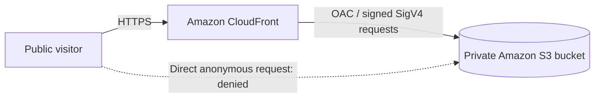

# SEG-01 — Restrict Public Access to Amazon S3

**Project:** Personal Cloud Portfolio  
**Status:** PASS — manually verified  
**Validation date:** November 12, 2026

## Problem and requirement

A technical professional needs to publish and maintain a portfolio securely, with reliable availability, controlled costs, repeatable updates, and without managing servers.

**SEG-01:** Visitors must be able to view the portfolio through Amazon CloudFront, while unauthenticated direct requests to the website files in Amazon S3 must be denied.

## Architecture

- **Amazon S3:** stores `index.html` and `styles.css` in a general-purpose bucket in `us-east-2`.
- **Amazon CloudFront:** distributes the website through HTTPS; `index.html` is the default root object.
- **Origin Access Control (OAC):** CloudFront authenticates its requests to the private S3 origin.

## Security configuration verified

- S3 **Block all public access** is enabled.
- S3 object ACLs are disabled.
- The bucket policy grants `s3:GetObject` to the service principal `cloudfront.amazonaws.com` for website objects, with an `AWS:SourceArn` condition restricting access to the intended CloudFront distribution.
- CloudFront uses an OAC with **Signature V4** and **Always sign requests**.
- The S3 bucket has not been made public to serve the website.

## Manual validation

| Check | Expected behavior | Observed result |
| --- | --- | --- |
| Open the portfolio via its CloudFront HTTPS URL | Website is displayed | PASS — website displayed |
| Open `index.html` directly from S3 without AWS credentials (before CloudFront setup) | Access denied | PASS — `AccessDenied` shown |
| Review S3 Block Public Access and bucket policy | No anonymous public read; CloudFront-specific permission | PASS — settings reviewed |
| Open `index.html` directly from S3 in an InPrivate window (after CloudFront setup) | Access denied | PASS — `AccessDenied` shown |
| Review CloudFront OAC settings | Signature V4 / Always sign requests | PASS — both settings confirmed |

The browser screenshots and AWS console views were reviewed during the manual tests. They have **not yet been added to this repository**. HTTP status codes were not independently recorded, so this document reports the observed page/error behavior rather than claiming measured response codes.

## Conclusion

**SEG-01 passed the manual checks above.** The website was accessible through CloudFront while anonymous direct access to its S3 objects remained denied. The S3 bucket policy and OAC settings support this intended access path.

This validates **SEG-01 only**; it is not a full infrastructure security audit.

## Remaining work

- Add sanitized evidence screenshots to the repository.
- Automate deployment and repeatable verification.
- Recreate and manage infrastructure using Terraform.
- Monitor actual costs and availability; neither has been measured in this validation.
